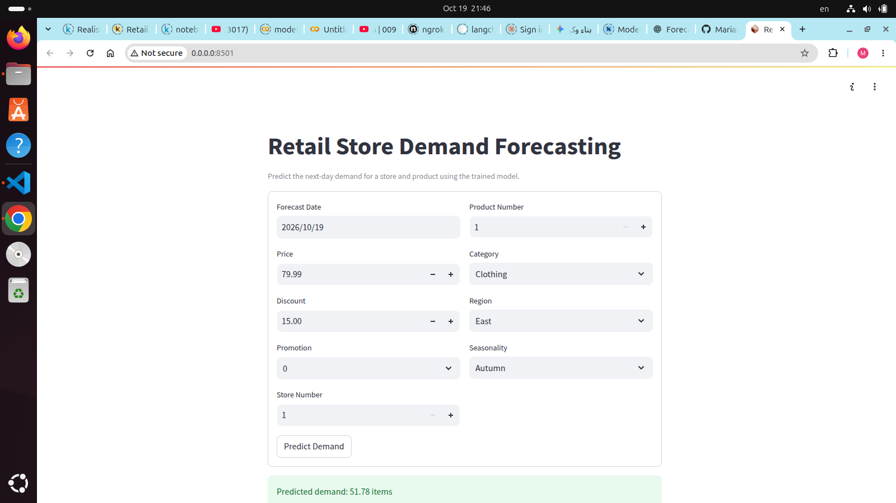

# Retail Store Demand Forecasting

This project predicts the demand for the next day using a trained machine learning model based on past retail data.

It includes:
- a trained XGBoost model saved in `models/demand_model.joblib`
- a FastAPI backend for prediction requests
- a Streamlit frontend for manual input and prediction display

## Model performance

The trained model achieved an accuracy of approximately 91% using the $R^2$ metric, which indicates strong predictive performance for this demand forecasting task.

## Project structure

- `app.py` — FastAPI backend
- `streamlit_app.py` — Streamlit frontend
- `src/predict.py` — model loading and feature generation logic
- `models/demand_model.joblib` — trained demand forecasting model
- `tests/` — unit tests for API and frontend validation

## How it works

The app accepts a set of input fields such as:
- date
- price
- discount
- promotion
- store number
- product number
- category
- region
- seasonality

It converts these user-friendly fields into the exact format expected by the trained model, then returns a predicted daily demand value.

## Requirements

The project uses a Conda environment named `demand_forecasting_env`.

You can activate it with:

```bash
conda activate demand_forecasting_env
```

If needed, install the dependencies:

```bash
pip install -r requirements.txt
```

## Run the API backend

From the project root:

```bash
cd /home/vboxuser/projects/Retail_Store_Demand_Forecasting
/home/vboxuser/anaconda3/envs/demand_forecasting_env/bin/python -m uvicorn app:app --host 0.0.0.0 --port 8000
```

Then open:

```text
http://localhost:8000
```

You can test the prediction endpoint with:

```bash
curl -X POST "http://localhost:8000/predict" \
  -H "Content-Type: application/json" \
  -d '{
    "Date": "2024-04-18",
    "Price": 79.99,
    "Discount": 15.0,
    "Promotion": 1,
    "store_number": 1,
    "product_number": 1,
    "Category": "Groceries",
    "Region": "North",
    "Seasonality": "Spring"
  }'
```

## Run the Streamlit frontend

From the project root:

```bash
cd /home/vboxuser/projects/Retail_Store_Demand_Forecasting
/home/vboxuser/anaconda3/envs/demand_forecasting_env/bin/streamlit run streamlit_app.py --server.address 0.0.0.0 --server.port 8501
```

Then open:

```text
http://localhost:8501
```

This will show a form where you can fill in the store, product, date, pricing, and category values and view the predicted demand result.

## Screenshot

The frontend prediction screen looks like this:



## Testing

Run the test suite with:

```bash
cd /home/vboxuser/projects/Retail_Store_Demand_Forecasting
/home/vboxuser/anaconda3/envs/demand_forecasting_env/bin/python -m pytest -q
```

This checks the API and frontend validation logic.

## Notes

- The Streamlit app is best for manual testing and user interaction.
- The FastAPI app is best for integration with other systems or frontend apps.
- The model expects category-based values such as store and product IDs, and the app translates user-friendly numbers into the correct format internally.

## Example result

A successful prediction might return:

```json
{
  "status": "success",
  "predicted_demand": 83.89,
  "unit": "items",
  "message": "Predicted demand for the selected date."
}
```
